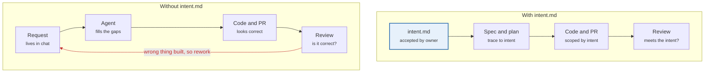
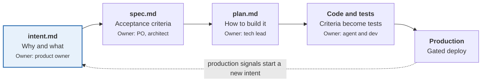
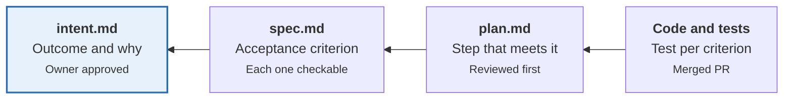
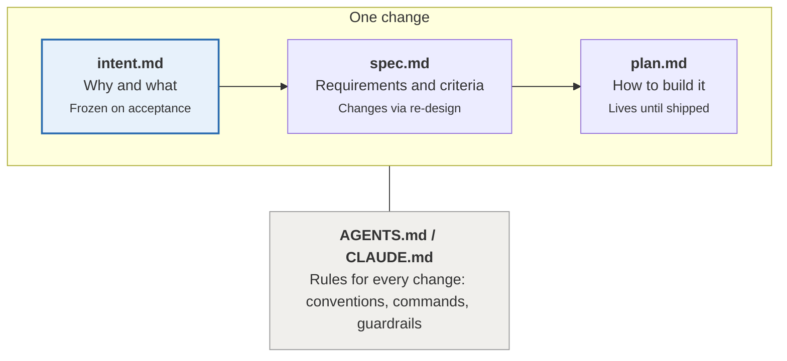
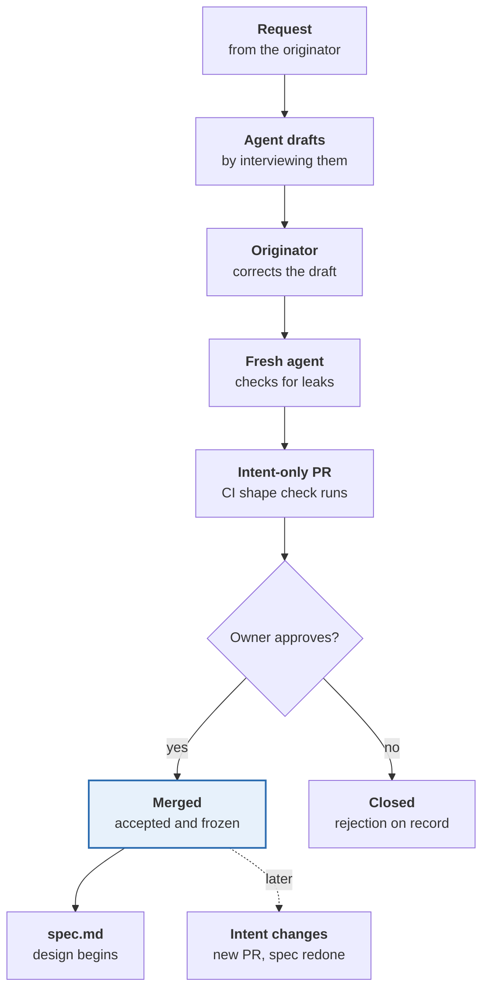
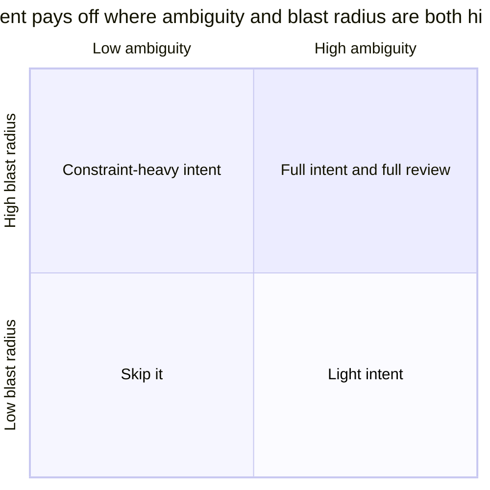

# Why intent.md: The Missing Artifact in the AI-Native SDLC

*Nov 13, 2026 · Aadesh*

## TL;DR

An **intent.md** is a short, owner-approved file that records *why* a change exists and *what observable outcome* it must produce, and never *how*. In an AI-native SDLC, agents can turn a request into a working PR in minutes, so code is no longer the scarce resource. The scarce resource is an agreed, reviewable statement of what was actually wanted. intent.md is that statement: it sits at the head of the artifact chain (intent → spec → plan → code), it is accepted through a PR like code, and every downstream artifact can be checked against it.

> **On naming:** intent.md is a convention, not a standard. It shows up in published AI-native SDLC methods and intent-driven development frameworks; other teams put the same content in a spec, a SYSTEM.md, or a ticket. The value is in the separation of *what/why* from *how*, not the filename.

## The problem: intent is the new bottleneck

Agents have made implementation cheap. They haven't made it cheap to know *what* to build. When intent has no home, three things go wrong:

- **Intent lives in chat.** Requirements scatter across prompts and session history: invisible to reviewers, gone when the session ends, and impossible to hand to the next agent.
- **Agents fill gaps with plausible defaults.** Ask for "photo sharing" and you get something that compiles and passes tests, but embodies scope and architecture decisions nobody made on purpose.
- **Review has nothing to review against.** A reviewer can confirm code is *correct*, but not that it's the *right* code, because "right" was never written down.



Without a written intent, the first time anyone checks the *what* is at review, after the code already exists.

The result is velocity without direction: fast output followed by expensive rework. Better prompting doesn't fix this. A durable artifact that captures intent *before* any agent starts does.

## What intent.md is, and is not

intent.md answers two questions: **why** does this change exist, and **what** outcome should it produce? It deliberately refuses to answer **how**.

| It contains | It excludes |
| --- | --- |
| The problem, in user or business terms, with evidence | Tables, endpoints, schemas |
| The proposed outcome, stated so someone could observe it | Libraries, frameworks, file paths |
| Who and what is affected | Code, pseudo-code, architecture |
| Constraints: regulatory, security, timing, compatibility | Task breakdowns and estimates |
| Open questions the originator can't answer yet | Solutions disguised as requirements |

A common template has a header (title, author and team, status `draft` or `accepted`, ticket ID) and five sections: **Problem, Proposed outcome, Affected users and systems, Constraints, Open questions.** If the originator insists on a design idea, it goes under Constraints, labeled as an *originator preference*: visible, but not smuggled in as a requirement.

It's short (one to two pages), in plain language, and owned by whoever owns the outcome: usually a product owner, but just as often a support engineer, an SRE or a developer.

## Where it sits in the artifact chain



Each artifact is committed and accepted before the next stage starts. The owner accepts the intent; one design session turns it into a spec with checkable acceptance criteria; a plan decides how to build; acceptance criteria become tests; and production signals feed the next intent. Because every link is a committed file, any line of code can be traced back to the outcome it was meant to serve, and any intent forward to the code that delivered it.

## The value: seven things intent.md buys you

1. **It moves the cheapest review to the front.** Catching a wrong outcome in a one-page intent costs minutes. Catching it in a merged PR costs a rewrite. Intent review is where human judgement buys the most per minute spent.
2. **It's durable context for agents.** An agent can only follow context it can read. intent.md survives session resets, model swaps and handoffs, so a planner agent, a coding agent and a reviewer agent all work from the same statement of purpose. That's essential in multi-agent setups.
3. **It's the yardstick for review.** With a written outcome, reviewers (human or agent) can ask "does this deliver the intent?" and not only "is this code correct?" The spec's acceptance criteria trace back to it.
4. **It contains scope creep.** Agents are eager. A frozen intent gives them, and their reviewers, a boundary: anything that doesn't trace to the intent is either out of scope or a new intent.
5. **It's an audit trail.** Accepted via PR, owned via CODEOWNERS and frozen on acceptance, intent.md records who asked for what, when, and who approved it. In regulated environments, that's the line from a change to its business justification that auditors and change boards ask for.
6. **It widens who can originate work.** With no implementation detail, a PM, support engineer or ops lead can author one, often with an agent interviewing them and drafting it, without needing to speak in code.
7. **It makes rework measurable.** Once intent and spec are committed artifacts, you can measure the gap between them and see when missing decisions are causing churn (see *Measuring it*, below).



Traceability is what makes benefits 3 and 5 real: reviewers and auditors can walk from any commit back to the outcome it serves, one hop at a time.

## intent.md vs its neighbors

| Artifact | Scope | Answers | Owner | Lifespan |
| --- | --- | --- | --- | --- |
| AGENTS.md / CLAUDE.md | Every change in the repo | How agents should behave here: conventions, commands, rules | Team | Long-lived |
| **intent.md** | One change | Why, and what outcome | Product owner or originator | Frozen on acceptance |
| spec.md | One change | Requirements and acceptance criteria, architecture, out of scope, policies applied, flagged concerns | PO, plus architect for risky changes | Changes only via re-design |
| plan.md | One change | How to build it, step by step | Tech lead or agent | Until shipped |



Instruction files set rules for *all* work; intent sets purpose for *one* piece of it; the spec turns purpose into checkable requirements; the plan turns requirements into steps. Collapsing intent into spec is the most common shortcut, and it's exactly what lets design decisions leak in before anyone has agreed on the outcome.

## Anatomy: a template

```markdown
# Intent: <short title>
Author: <name> · Team: <team> · Status: draft | accepted · Ticket: <ID>

## Problem
<What's wrong today, for whom, and how we know. Evidence, not opinion.>

## Proposed outcome
<What will be observably different when this is done. Each outcome should be
something a user, an operator or a metric could confirm.>

## Affected users and systems
<Who feels this change. Which systems are touched, by name, not internals.>

## Constraints
<Regulatory, security, timing, compatibility, cost.>
<Originator preference: <design idea>, if any, labeled as such.>

## Open questions
<What the originator doesn't know yet. Design answers these; agents don't guess.>
```

**A quick test for a good intent:** could two different teams read it, build different implementations, and both be right? If yes, it states intent. If it forces one implementation, it's a spec wearing an intent's clothes.

## Making it stick: governance

A file convention only adds value if it's enforced. Patterns that work:

- **Accept by PR.** The intent lands as a PR containing only the intent file. The owner approves, the status flips to `accepted` in the same PR, and merging is the acceptance. Closing it is a recorded rejection.
- **CODEOWNERS and branch protection.** Product owners own `intent/**`, and their review is required.
- **A shape check in CI.** A script verifies the required sections, the author and status line, the absence of code or file paths, and that intent PRs touch only intent files. Run it from the trusted base branch so an agent can't edit its own checker.
- **Freeze on acceptance.** Changing intent means a new PR, which sends the spec back through design. This is what makes traceability real.
- **Agent drafts, human owns.** An agent interviews the originator and drafts; the originator corrects; a fresh agent session reviews for design leaks, unobservable outcomes, missing constraints and unsourced claims.
- **Advisory vs enforced.** intent.md, like any instruction to an agent, makes intent *reviewable*; it can't force compliance. Rules that must always hold belong in deterministic checks: hooks, tests and deploy gates.



Drafting is cheap and agent-assisted; acceptance is a human decision recorded in git.

## Where it doesn't pay, and how it fails

- **Small or invisible changes.** Refactors, dependency bumps and anything nobody outside the team can observe can skip intent. Requiring it everywhere turns it into ceremony.
- **When stating it is harder than building it.** For small, well-understood problems, writing precise intent can cost more than the work. The payoff grows with ambiguity, risk, and the number of people and agents touching the change.
- **Design leakage.** An intent that names endpoints or tables has made a design decision without design review. The shape check and reviewer agent exist to catch this.
- **Unobservable outcomes.** "Improve the experience" can't be verified, so the spec can't derive acceptance criteria from it.
- **Intent rot.** If intents get edited in place after build starts, the chain breaks. Freeze them; supersede them.
- **Rubber-stamp acceptance.** If owners approve without reading, you've added latency without judgement. A healthy process rejects some intents.



| Quadrant | Typical changes |
| --- | --- |
| Full intent and full review | New user-facing capability |
| Constraint-heavy intent | Regulatory changes, migrations, shared APIs |
| Light intent | A few lines, fast acceptance |
| Skip it | Refactors, dependency bumps |

A rule of thumb for triage: the more ambiguous the ask and the more it touches (people, agents, risk), the more an intent earns its keep.

## Measuring it, and getting started

**Leading indicators**

- Time from first request to merged intent: should be hours to days, not weeks.
- Time from the intent commit to the accepted spec commit.

**Lagging indicators**

- Share of intents accepted vs closed: a filter that never rejects isn't filtering.
- Spec commits made after the first plan commit: a proxy for rework caused by decisions the intent or spec missed.
- How often intents change after the first spec commit.

**A two-week pilot**

1. Pick one team and one class of user-visible change.
2. Add `intent/TEMPLATE.md`, a CODEOWNERS entry and a simple shape check in CI.
3. Give the agent a skill or prompt that interviews the originator and drafts the intent; have a fresh session review it.
4. Require an accepted intent before any spec or plan for that change class.
5. After two weeks, compare rework (post-plan spec edits, reopened PRs, review churn) with the previous period, and decide whether to widen it.

## Sources

- [Plan: capture intent.md, AI-native SDLC (Developer Toolkit)](https://developertoolkit.ai/en/method/lifecycle/plan/)
- [Design: write spec.md, AI-native SDLC (Developer Toolkit)](https://developertoolkit.ai/en/shared-workflows/ai-native-sdlc/design/)
- [What is spec-driven development? (Vercel)](https://vercel.com/i/spec-driven-development)
- [Spec-Driven Development with Spec Kit (Agent Patterns)](https://www.agentpatterns.ai/workflows/spec-driven-development/)
- [Why Intent Is the New Bottleneck in AI Development (Devplan)](https://www.devplan.com/blog/intent-layer-ai-development)
- [How to write a good spec for AI agents (Addy Osmani)](https://addyosmani.com/blog/good-spec/)
- [Intent-Driven Development (Russell Romney)](https://russellromney.com/blog/intent-driven-development)
- [Intent-Driven Development Framework (GrillerGeek/idd-framework)](https://github.com/GrillerGeek/idd-framework)
